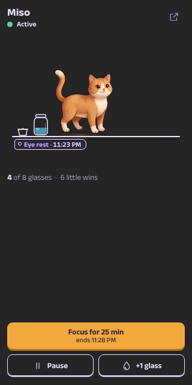

  

<h1 align="center">OiBuddy</h1>

<strong>A tiny friend lives in your editor.</strong> 
It reminds you to drink water, rest your eyes, stretch and walk, and it waits for a natural pause.

> **Preview.** OiBuddy is new and still growing. The buddies' movements and voices are still being polished, so expect small changes in coming updates.

## Contents

- [What it does](#what-it-does)
- [Meet the crew](#meet-the-crew)
- [Getting started](#getting-started)
- [How it behaves](#how-it-behaves)
- [Make it yours](#make-it-yours)
- [Commands](#commands)
- [Privacy and data](#privacy-and-data)
- [Feedback](#feedback)

## What it does

- **A home in the sidebar.** Your buddy lives on a shelf. It reads while you type, nods when you save, wanders, waves and naps when you step away, then welcomes you back. A jar fills with today's water, and a sprout grows as you keep meeting your water goal.
- **Gentle visits.** When a reminder is due, your buddy walks in with a speech bubble. Choose **Do it with me** for a short guided break, or **Done**, **Later** or **Skip**.
- **The status bar.** Your buddy's face shows what is next, such as "Water in 12 min", "Miso is waiting" or "Focus · 18 min left". While a reminder waits, it plays peekaboo behind the shelf. Click it to open your buddy.
- **A peek in your code.** While a reminder waits, your buddy peeks out beside the line numbers and ducks away as soon as you type. Hover that line to read the reminder or call your buddy in now.
- **A shelf in the bottom panel.** Next to the Terminal, your buddy strolls along a wide shelf, plays hide-and-seek (click it when you spot it) and comes in for reminders.
- **Focus sessions and focus sounds.** Start a focus session from the sidebar, the dashboard or **Quick Actions**. Play original lofi tracks, rain, fireplace, café, night or wave sounds, on their own or every time a session starts.
- **A dashboard.** Your day on one timeline, the week's water, your little wins, your reminders, settings and the crew.

## Meet the crew

Pick a buddy during setup, switch any time on the crew page, and give them your own name.

| Buddy   | Who     |
| ------- | ------- |
| Miso    | Cat     |
| Biscuit | Dog     |
| Clover  | Rabbit  |
| Pebble  | Penguin |
| Rusty   | Fox     |
| Theo    | Boy     |
| Maya    | Girl    |

Each buddy walks in on painted legs and has its own voice in English, Hindi and Bengali.

## Getting started

1. Install **OiBuddy** from the Extensions view.
2. Click the **OiBuddy** icon (a little face peeking over a ledge) in the Activity Bar.
3. A three-step setup asks for your buddy, your rhythm and your working hours. That's it.

## How it behaves

- **It waits for you.** Reminders hold while you type, debug or run a task. A waiting buddy peeks in and comes over at your next pause. After 10 minutes, it comes in at the next short break in your typing.
- **Breaks count.** Five minutes or more away from the keyboard counts as a break for your eyes, stretches and walks. Time spent in another app does not.
- **No pile-ups.** Visits are spaced out. After quiet hours, sleep or time away, you get one overdue reminder instead of a burst.
- **Honest progress.** **Done** counts as progress. **Later** brings your buddy back in 5 minutes, 15 minutes or your usual Later time. Skipping, missed visits, pauses and edits never count as progress.
- **Kind suggestions.** If a reminder keeps getting skipped, OiBuddy suggests a longer interval. When a focus session ends, your buddy offers a short break.
- **Easy pauses.** Pause for 30 minutes, an hour or until work starts again. Reminders come back on their own.

## Make it yours

- **Name your buddy** on the crew page. The name shows in speech bubbles, notifications and the status bar.
- **Language:** English, हिन्दी or বাংলা for every screen and everything your buddy says.
- **Rhythm:** working days, hours to the minute, overnight shifts, Later time for each reminder, focus sessions from 1 to 240 minutes and eight ready-made habits to add.
- **Water:** log a glass any time with **+1 glass**, in millilitres or ounces.
- **Sound:** voice, sound effects and focus sounds are optional and start off. Voice and sound effects share one volume; focus sounds have their own.
- **Where it shows up:** turn the code peek, the status-bar peekaboo and the bottom-panel shelf on or off in Settings, or with `oibuddy.peekInCode`, `oibuddy.animateStatusBar` and `oibuddy.bottomPanel`. All three start on.
- **Comfort:** OiBuddy follows your light, dark or high-contrast theme. **Reduce animation** and your system's reduced-motion setting are respected everywhere.

## Commands

| Command                             | What it does                                                               |
| ----------------------------------- | -------------------------------------------------------------------------- |
| OiBuddy: Open Dashboard             | Opens the full dashboard                                                   |
| OiBuddy: Quick Actions              | Log water, start or end focus, pause or resume, play sounds or try a visit |
| OiBuddy: Log a Glass of Water       | Records one glass                                                          |
| OiBuddy: Play or Pause Focus Sounds | Starts or stops focus sounds                                               |
| OiBuddy: Pause or Resume Reminders  | Pauses reminders until you resume them                                     |
| OiBuddy: Try a Visit                | A practice visit that doesn't count toward progress                        |
| OiBuddy: Open Data Folder           | Shows where your data is stored                                            |

## Privacy and data

- **Stays on your computer.** Your settings, reminders and progress are saved in VS Code's local storage for extensions. No account, no tracking and no network requests: fonts, artwork and audio all ship inside the extension.
- **One buddy across windows.** Every VS Code window shares the same buddy, and each visit shows in only one window. Saves from different windows never overwrite each other.
- **Safe from damage.** If a saved file is damaged, OiBuddy restores the last good backup and keeps the damaged file until your next change. Data saved by a newer version of OiBuddy is never overwritten.

## Feedback

Found a bug or have an idea? [Open an issue](https://github.com/SoubhikBiswas-gitHub/oibuddy-vscode/issues).

## License

All rights reserved. See [LICENSE](LICENSE).
