

  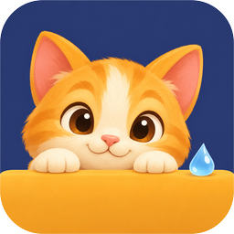

<h1 align="center">OiBuddy</h1>

<strong>A tiny friend lives in your editor.</strong> 
Gentle reminders to drink water, rest your eyes, stretch and walk, timed to your pauses.

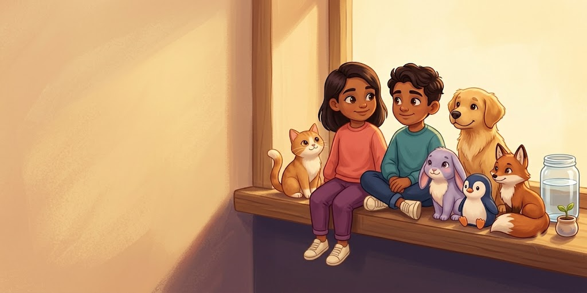

A long stretch of coding can make a glass of water or a short break easy to forget. OiBuddy gives those moments a friendly face: a painted buddy who shares your workspace and waits for a natural pause before visiting.

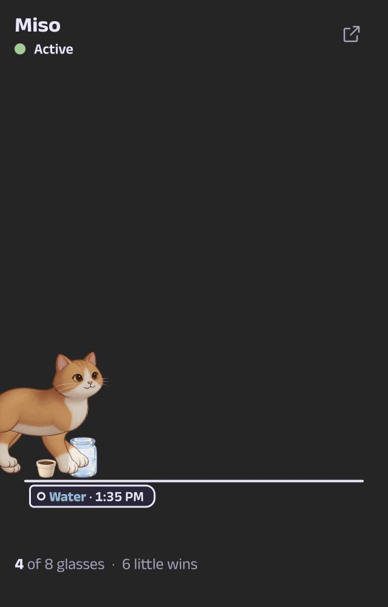

> **Preview.** OiBuddy is new and still growing. The buddies' movements and voices are still being polished, so expect small changes in coming updates.

## A home in the sidebar

Your buddy reads while you type, nods when you save, wanders, waves and naps when you step away, then welcomes you back. A jar fills with today's water, and a sprout grows as you keep meeting your water goal. The next reminder is always close by.

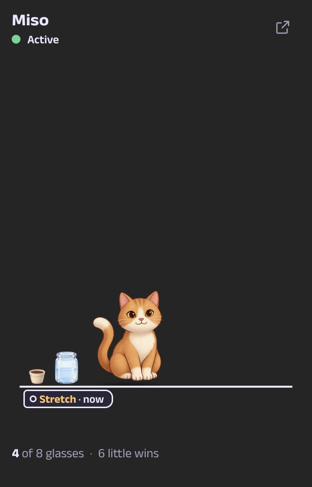

## A little break, together

When a reminder is due, your buddy walks in with a speech bubble. Choose **Do it with me** for a short guided break, or **Done**, **Later** or **Skip**. Practice visits let you try it without adding to your progress.

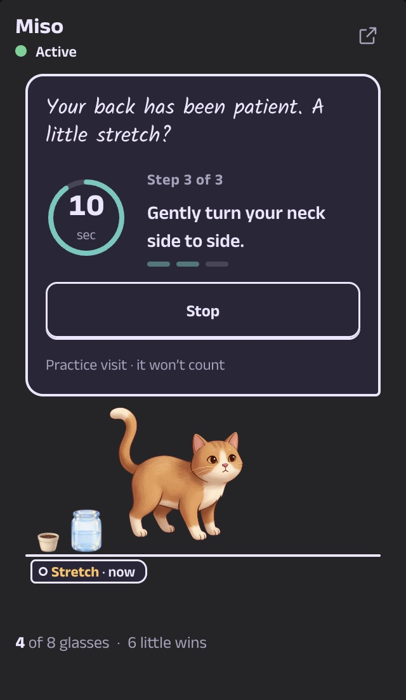

## Later is okay

Busy at the moment? Choose **Later**. Your buddy gives a gentle sigh and shows when it will return. Pick 5 minutes, 15 minutes or your reminder's usual Later time.

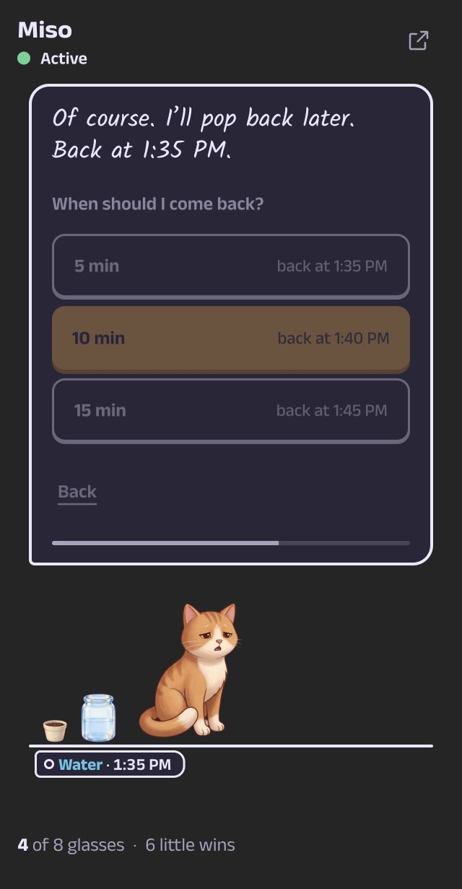

## A peek in your code

While a reminder waits, your buddy peeks out beside the line numbers and ducks away as soon as you type. Its face in the status bar shows what is next, from the next water break to the time left in a focus session. Click the status bar to open your buddy.

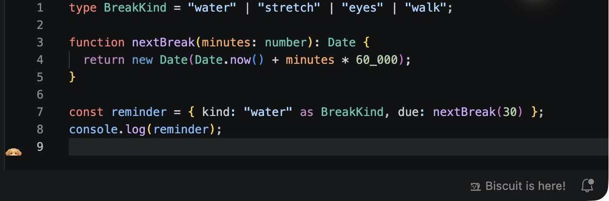

Hover the peek to read the reminder or choose **Come in now**.

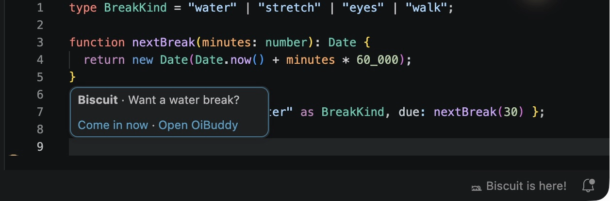

## A shelf beside the Terminal

Prefer a wider home? Open the bottom-panel shelf. Your buddy strolls, sometimes hurries or does a little hop, and plays hide-and-seek. Click when you spot it.

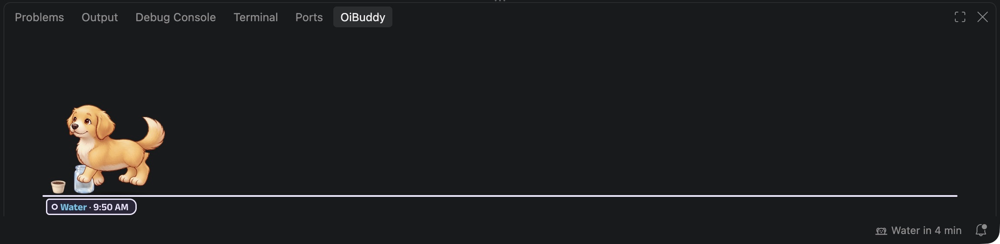

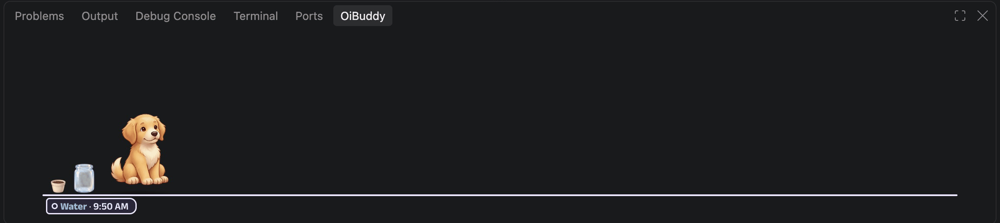

## Find your focus sound

Play original lofi tracks with rain, fireplace, café, night or wave ambience. Start them on their own or with a focus session. Focus sounds have their own volume and get quieter while your buddy visits. Voice, sound effects and focus sounds are optional and start off.

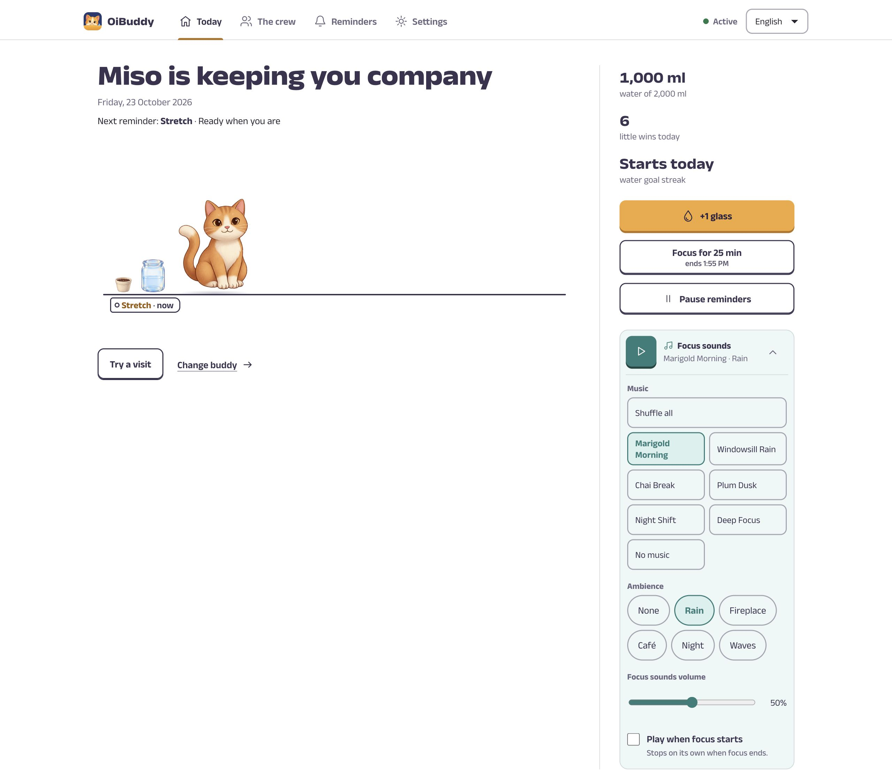

## See your day, kindly

The Today dashboard puts your day on one timeline: water, breaks and little wins. Look back at the week's water or log a glass whenever you like, in millilitres or ounces.

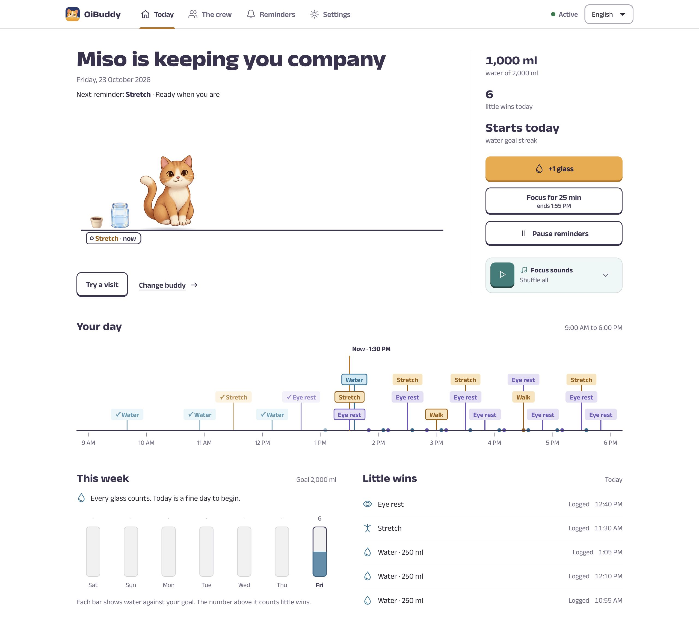

## English, हिन्दी and বাংলা

Choose your language for every screen and everything your buddy says. Each buddy has its own voice in English, Hindi and Bengali. English is the default.

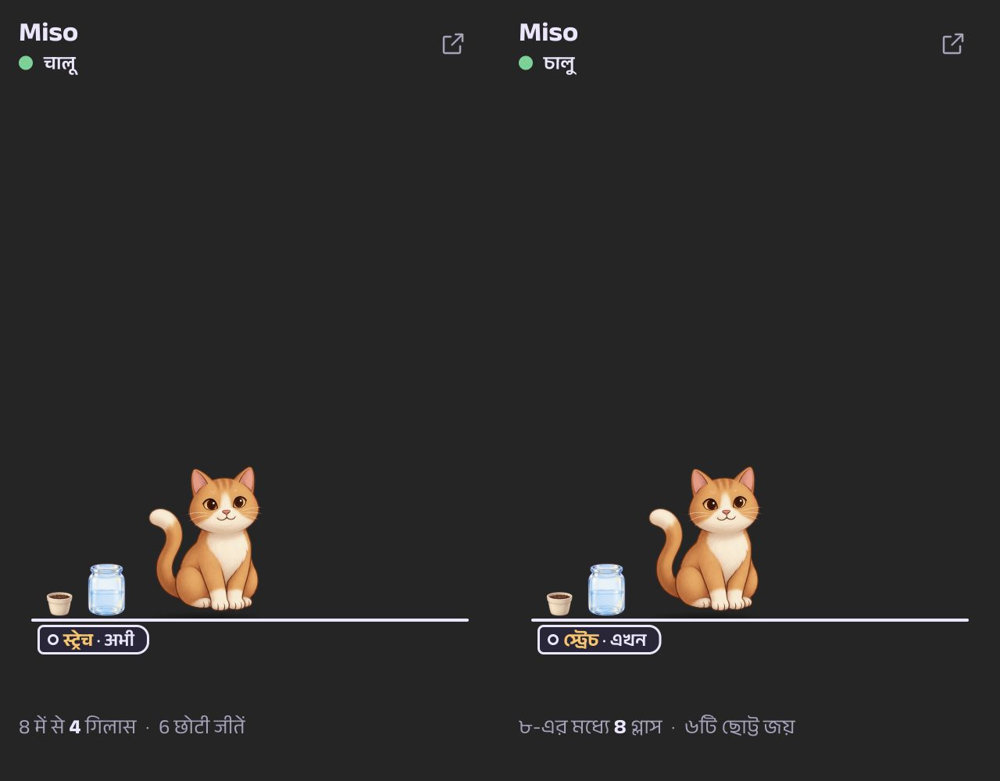

## Make it yours

### Meet the crew

Choose Miso the cat, Biscuit the dog, Clover the rabbit, Pebble the penguin, Rusty the fox, Theo or Maya. Pick during setup, switch any time on the crew page, and give your buddy your own name. Their finished looks stay the same.

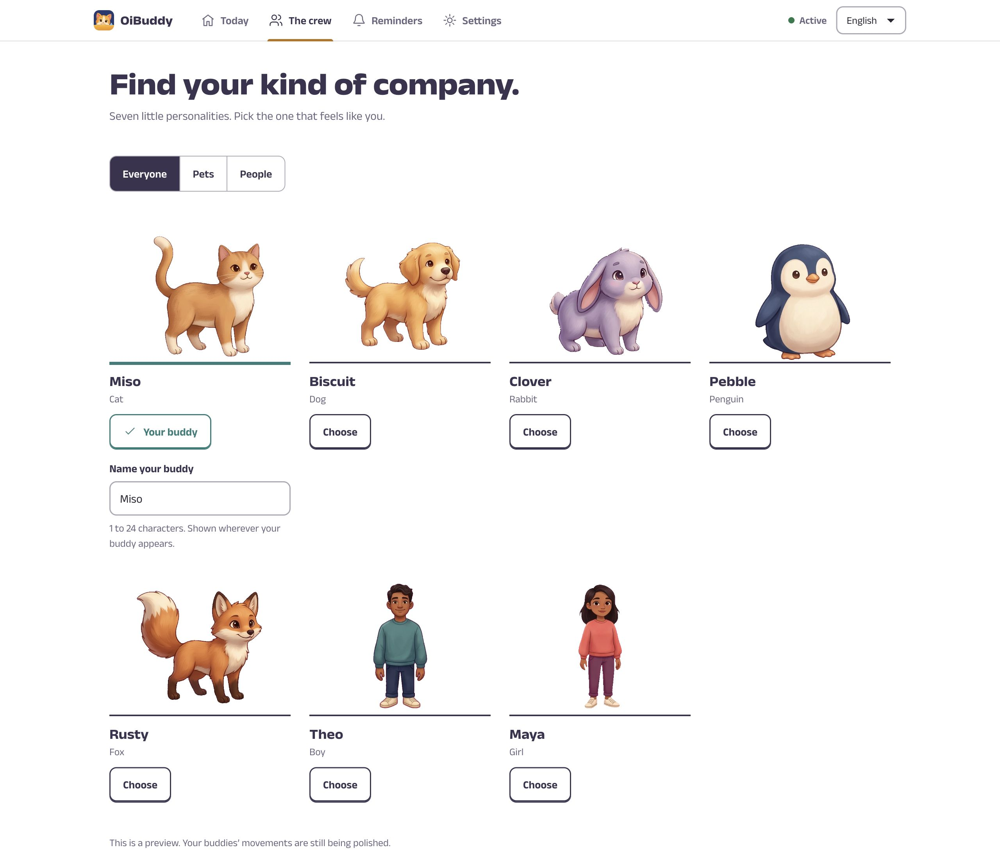

### Set your rhythm

Choose working days, hours to the minute, overnight shifts and Later time for each reminder. Add one of eight ready-made habits, or set up a custom reminder. Focus sessions can last from 1 to 240 minutes.

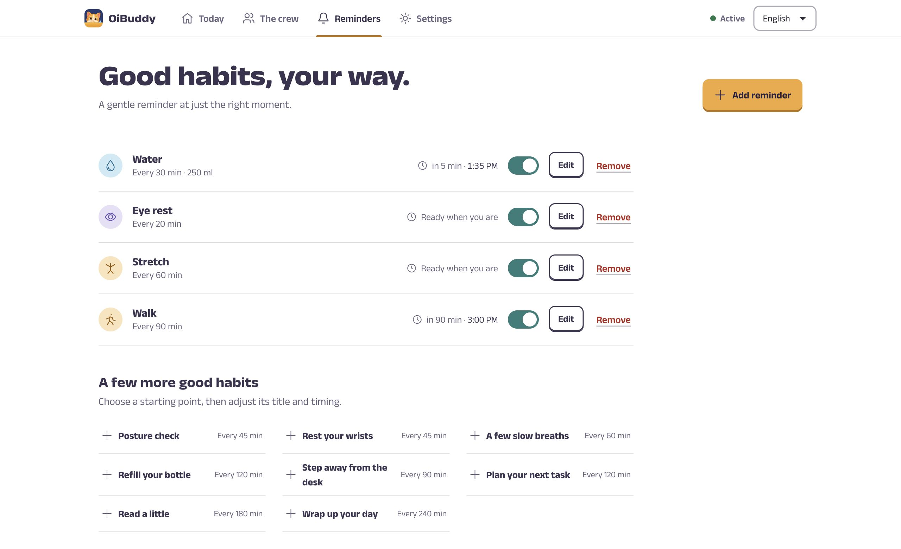

### Choose where your buddy appears

Turn the code peek, status-bar peekaboo and bottom-panel shelf on or off in Settings. All three start on. OiBuddy follows your light, dark or high-contrast theme; **Reduce animation** and your system's reduced-motion setting are respected everywhere.

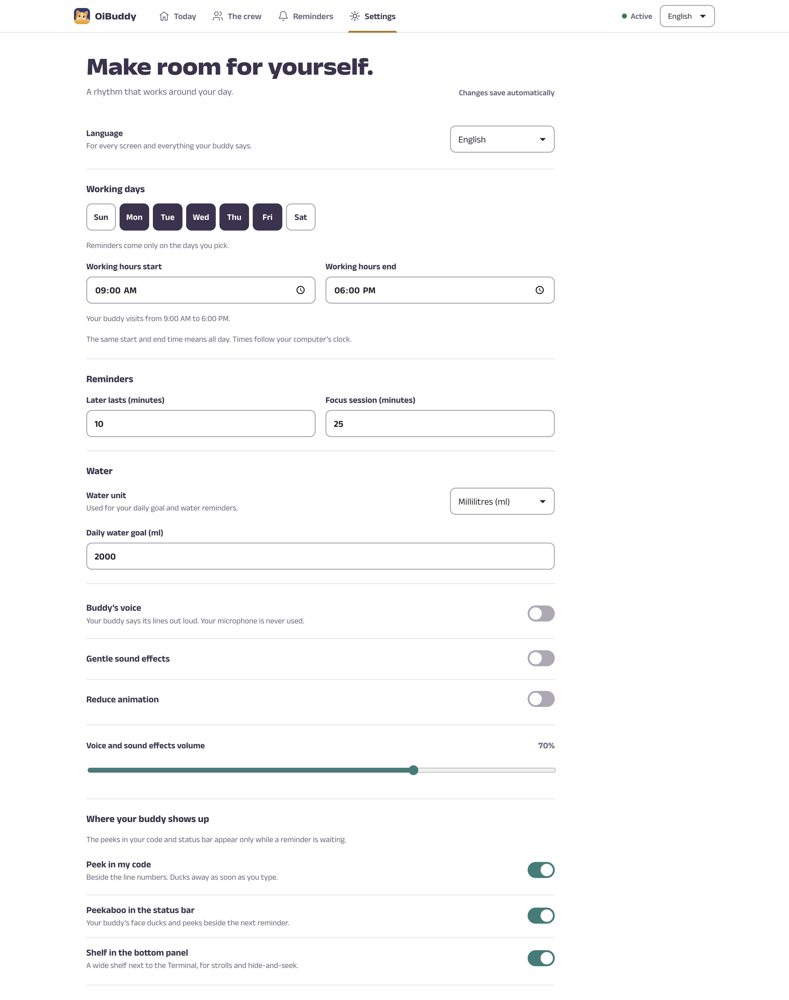

## Getting started

1. Install **OiBuddy** from the Extensions view.
2. Click the **OiBuddy** icon, a little face peeking over a ledge, in the Activity Bar.
3. Choose your buddy, your rhythm and your working hours in the three-step setup.

## How it behaves

- **It waits for you.** Reminders hold while you type, debug or run a task. A waiting buddy visits at your next pause. After 10 minutes, it comes in at the next short break in your typing.
- **Breaks count.** Five minutes or more away from the keyboard counts as a break for your eyes, stretches and walks. Time spent in another app does not.
- **No pile-ups.** Visits are spaced out. After quiet hours, sleep or time away, you get one overdue reminder instead of a burst.
- **Honest progress.** **Done** counts. Skipping, missed visits, pauses and edits never count as progress.
- **Kind suggestions.** If a reminder keeps getting skipped, OiBuddy suggests a longer interval. When a focus session ends, your buddy offers a short break.
- **Easy pauses.** Pause for 30 minutes, an hour or until work starts again. Reminders come back on their own.

## Commands

| Command                             | What it does                                                               |
| ----------------------------------- | -------------------------------------------------------------------------- |
| OiBuddy: Open Dashboard             | Opens the full dashboard                                                   |
| OiBuddy: Quick Actions              | Log water, start or end focus, pause or resume, play sounds or try a visit |
| OiBuddy: Log a Glass of Water       | Records one glass                                                          |
| OiBuddy: Play or Pause Focus Sounds | Starts or stops focus sounds                                               |
| OiBuddy: Pause or Resume Reminders  | Pauses reminders until you resume them                                     |
| OiBuddy: Try a Visit                | A practice visit that does not count toward progress                       |
| OiBuddy: Open Data Folder           | Shows where your data is stored                                            |

## Privacy and data

**Your buddy stays on your computer.** No account, no tracking and no network requests. Fonts, artwork and audio ship inside the extension; settings, reminders and progress stay in VS Code's local extension storage.

Every VS Code window shares the same buddy, and each visit shows in only one window. Saves from different windows never overwrite each other. If a saved file is damaged, OiBuddy restores the last good backup and keeps the damaged file until your next change. Data saved by a newer version is never overwritten.

## Feedback

Found a bug or have an idea? [Open an issue](https://github.com/SoubhikBiswas-gitHub/oibuddy-vscode/issues).

## License

All rights reserved. See [LICENSE](LICENSE).
